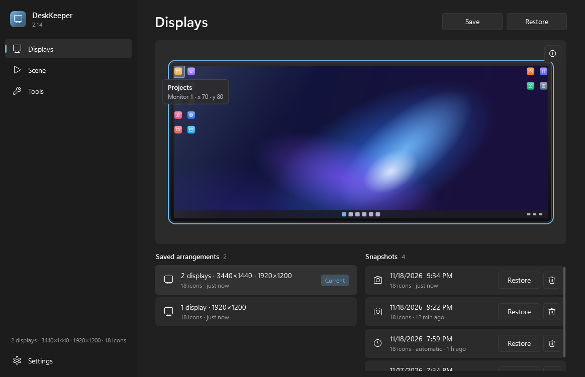
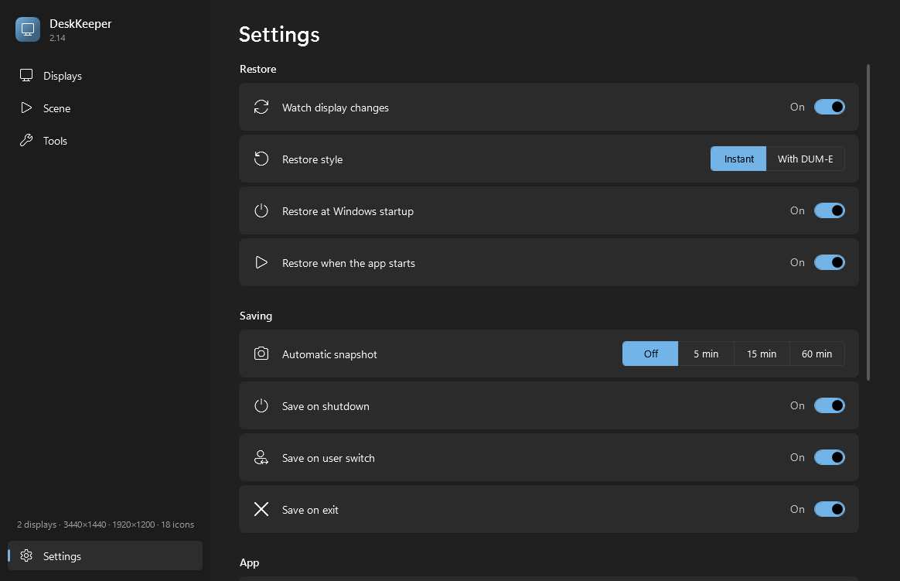
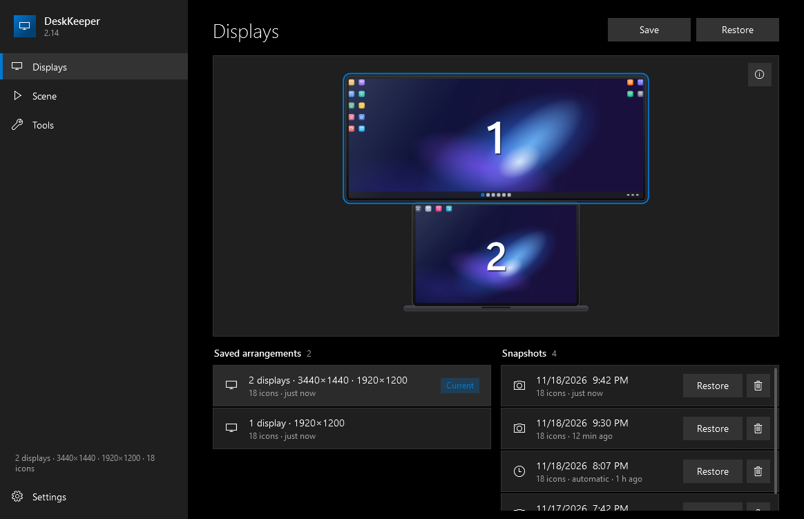
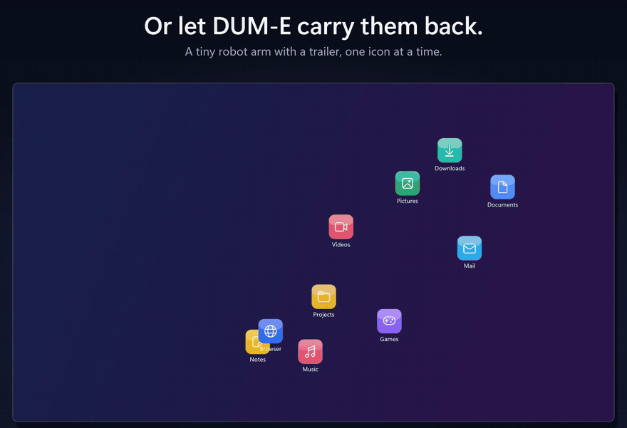
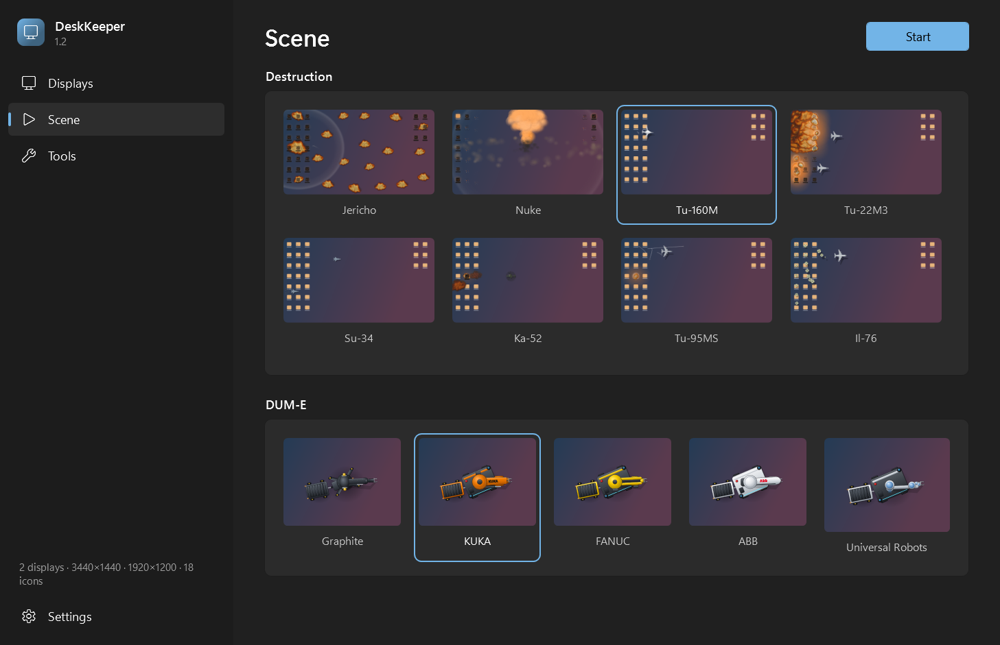

<div align="center">

# DeskKeeper

**Your desktop icons. Exactly where you left them.**

Windows has one job when you plug in a monitor: remember where your icons were.
It has been failing at that job since roughly 1995. DeskKeeper does it instead.


[Download](../../releases) · [Watch the 30-second promo](https://cdn.jsdelivr.net/gh/VenzyProgramming/DeskKeeper@main/docs/media/deskkeeper-promo.mp4) · English · [Deutsch](#deutsch) · [Русский](#русский)

</div>

---

## The problem

You have a laptop. You have a lovely ultrawide. You spent a Sunday afternoon sorting your desktop icons into a layout so beautiful it should be in a museum.

Then you unplug the monitor. Windows panics and stacks everything onto the laptop screen. You plug it back in. Windows looks at your carefully curated layout and does a little shuffle dance with it. *Your Steam icon is now next to your tax returns.*

## The fix

DeskKeeper sits quietly in the tray and remembers your icon layout **per display arrangement** – which screens are connected, where they sit, which one is the main display, resolution and scaling.

- **Monitor plugged in, unplugged, laptop lid closed, main display swapped?** DeskKeeper waits until Windows has finished its shuffle, then puts every icon back.
- **It knows which screen an icon belongs to.** Not just "x = 1200", but "on the LG ultrawide, 120 px from the left". So icons land on the right device even when you move screens around or switch the main display.
- **Never seen this combination before?** Icons go back to the screen they last lived on. Different resolution on the same screen? Positions are scaled proportionally.
- **Windows forgot everything after a reboot?** Restored a few seconds after startup.
- It never saves Windows' own mess under your good layout. That was the whole point.

## Features

| | |
|---|---|
| **Displays view** | Your screens drawn as real devices – monitor, laptop, tablet, phone, TV, wireless or virtual displays – to scale, with your actual icons on them. Click a device to zoom in, hover an icon to see exactly where it sits. |
| **Snapshots** | Save a layout whenever you like, restore it later, or remove it (it goes to a recycle folder, not into the void). Automatic snapshots every 5/15/60 minutes, only when something changed. |
| **Saves when it matters** | On shutdown, on user switch / lock, and on exit. |
| **Restores when it matters** | At Windows startup, at app start, and whenever the display arrangement changes. Instantly – or with DUM-E (see below). |
| **Sort by category** | One click puts system icons top left, social apps and browsers top centre, Office top right, video and image tools next to it, development tools bottom left, games and launchers bottom centre, everything else bottom right. A snapshot is taken first, so you can go back. |
| **Keep icons on the grid** | Every restore snaps icons into grid cells, also after a scene. During a scene the grid is off so icons can disappear cleanly; afterwards they return to their saved places and snap in. |
| **Tools** | Minimize all windows, show/hide desktop icons, icon size, align to grid, auto arrange, save/load a layout to a file. |
| **Feels native** | Detects Windows 10 or 11 and looks like the system settings of each, dark or light, uses your accent colour. English, Deutsch, Русский. |
| **Tray app** | Starts with Windows if you want, starts minimized, closes to the tray, remembers its window position. |

<p align="center">
   
   
   
</p>

## What's new in 1.3.1

- **Su-25:** the wingtips now reach the airbrake pods (there was a gap before), and the camouflage and slat lines stay inside the wing.
- **Mi-26:** the tailplane runs right through the tail boom with a realistic chord.
- **Su-34:** three well-spaced stations per wing: KAB-500L inboard, Kh-29L in the middle, R-73 outboard.

## What's new in 1.3.0

- **Models checked against real top views.** Each outline was traced from a real top view and compared with the model one model unit at a time. The sources are a public-domain orthographic view for the Su-34 and three-view drawings from Wikimedia Commons for the others.
- **Su-34 rebuilt from the traced outline:** slim nose with the long grey radome, canards, fins on the nacelles, nozzles behind the nacelles, the teal camouflage, and R-73s on the wingtip rails.
- **Su-25 corrected:** the engine nacelles start much further back and end at the tail boom, the trailing edge, tailplane and wingtip pods have moved, the fuselage is slimmer, and it has twin nose booms.
- **A-10C:** wing moved forward with the right chord, slimmer fuselage, shorter TF34 nacelles and twin fins.
- **AC-130U:** pointed radome nose, trailing edge moved aft.
- **Tu-95MS:** slimmer fuselage.
- **Il-76:** finer nose.
- **CH-47 Chinook:** the wide body with fuel pods runs almost the full length.
- **Mi-26:** rotor head about a third of the way back from the nose.

## What's new in 1.2.9

- **One true scale for every aircraft and helicopter.** The Tu-160M is the reference, and one desktop icon is the size of a 6 m container. Every model is drawn at its real size: the Tu-160M is 9 icons long, the Tu-95MS and Il-76 about 7.5, the Su-34 4, the A-10C 2.7, the Ka-52 2.3 and the Shahed-136 0.6. The Chinook and Mi-26 now carry icons like containers on the hook (up to four or eight).
- **Su-34 redrawn:** the flat "platypus" nose with sharp chines, the wide side-by-side cockpit, engine tunnels, Kh-29 and R-73 under the wings, and Khibiny wingtip pods.

## What's new in 1.2.8

- **More detail on the existing models.**
  - Tu-160M: wing fences, the all-moving tailplane and upper fin, crew escape hatches, antennas and the tail cone.
  - Tu-22M3: auxiliary intake doors, the tail turret with GSh-23 and its fire-control radar, elevators and navigation lights.
  - Su-34: Khibiny wingtip pods, the dorsal airbrake, the refuelling probe, the tail radar and panel lines.
  - Ka-52: Vitebsk missile-warning sensors, UV-26 flare dispensers, rudders and navigation lights.
  - Tu-95MS: three wing fences per side and the glazed tail turret.
  - Il-76MD: slats, three-part flaps, spoilers and the tail turret.

## What's new in 1.2.7

- **Three new scenes.** A **Shahed-136 swarm**: dozens of delta-wing loitering munitions come in slow and low from the edge of the screen, each one heading for an icon, and dive steeply onto it in the last stretch. **A-10C**: one low strafing run per group of icons along the row, the GAU-8 burst walks from icon to icon, larger groups take an AGM-65 Maverick first, and the jet pops flares as it pulls off. **Su-25**: alternates S-8 rocket salvos from the B-8M1 pods with 30 mm gun runs.
- **Two new helpers: CH-47F Chinook and Mi-26.** They hover over the icons, pick them up in a cargo net on the hook (up to six or ten), and set each one down in its place. On short distances they sidestep in the hover, and the downwash kicks up dust.
- All five new models are drawn from real top views. The Shahed-136 has elevons and a pusher prop. The A-10C has TF34 nacelles, twin tails, gear pods, slats, decelerons and its refuelling receptacle. The Su-25 has wingtip airbrake pods, B-8M1 pods, FAB-250s, R-60s and twin air-data booms. The Chinook has tandem three-blade rotors and T55s on the aft pylon. The Mi-26 has its eight-blade rotor, D-136 engines with dust protection, clamshell doors and a five-blade tail rotor.

## What's new in 1.2.6

- **New scene: AC-130U gunship.** It circles each group of icons in a left-hand orbit, lets the group hold out for a few seconds with near misses, then takes the icons out one after another with the 105 mm howitzer, the 40 mm Bofors and the 25 mm GAU-12, and flies on to the next group. The guns turn towards their target, the howitzer recoils, and powder smoke drifts off the gun ports. Drawn from the real top view: four T56 engines with six-blade props, external tanks, sensor turrets, flare dispensers, LAIRCM turrets and navigation lights.
- **Three new helpers** besides DUM-E, chosen under Scene → Helper: a forklift with a pallet, a crane truck with outriggers and a slewing boom, and a swarm of delivery drones with a landing pad.
- **Tu-22M3:** after the last bomb it sweeps its wings back to 65°, lights both afterburners and accelerates away.

## What's new in 1.2.5

- **Bombs hit icons, not empty desktop.** Every attack now aims at your actual icons, wherever they sit on your screens. Cruise missiles (Tu-160M, Tu-95MS) target groups of neighbouring icons, with each impact on an icon. The Tu-22M3 and Su-34 fly their rows where your icons are, across all displays, and the carpet drops a second bomb next to each icon instead of into the gaps. Jericho's main blast and its rockets land on an icon, not between icons. The Ka-52's rockets and Vikhr missiles hit the icon itself.
- An icon only catches fire when an impact is within reach, no longer from a far-away shock wave.

## What's new in 1.2.4

Tested on a real laptop + ultrawide setup in every Win+P mode (PC screen only, Duplicate, Extend with either main display, Second screen only):

- **Groups stay groups.** Icons that sit next to each other move together onto the laptop screen, so a column at the bottom left stays a column at the bottom left.
- **Two-screen layouts win.** Extending after a laptop-only session no longer pulls every icon onto the laptop: arrangements with the same displays as now come first, newer ones only after that.
- **Duplicate mode** gets its own hardware ID (both monitors).
- **The guard after a restore** compares against what Explorer actually accepted after snapping, and never starts DUM-E.
- Derived targets snap to Explorer's grid, so icons are only counted as moved when they really are.

## What's new in 1.2.3

- **Displays are remembered by their hardware ID.** Each arrangement is keyed by the monitor's device path from the Windows display configuration together with its real pixels and scaling, so two setups with the same resolution can no longer be mixed up. The laptop panel now gets its ID in laptop-only mode too. Existing arrangements are moved to the new keys automatically.
- **Laptop only? Same layout as on the big screen.** When the display an icon was last seen on is missing, DeskKeeper places it on the main display in the same spot: columns on the left stay on the left, the group in the top right stays in the top right, icons near the bottom stay at the bottom.
- Real pixels come from the current display mode, so a host app with system DPI can no longer skew them.
- **Tu-22M3, Su-34 and Il-76 redrawn** from measured three-view drawings. The Tu-22M3 now sweeps its wings back to 65° after the last bomb. Like the Tu-160, both wing positions come from the drawing and every outline point turns around the pivot that both positions define.

## What's new in 1.2.2

- **Mixed scaling fixed.** Started while the laptop screen (125 %) was the main display, DeskKeeper saw a 3440×1440 monitor as 4300×1800. Layouts landed under a wrong key, icons were squeezed, and older snapshots seemed to be gone. DeskKeeper now always works in real pixels, the way Explorer does. Arrangements that were stored with the wrong scaling are moved aside (`profile\quarantaene-dpi`), not deleted.
- **Monitor off and on again:** if Windows shuffles the icons once more right after DeskKeeper has put them back, DeskKeeper puts them back again instead of saving the mess.
- **Before a layout is overwritten** with many icons in new places, the old one is kept as an automatic snapshot.
- **Snapshots of other display arrangements can be restored.** Icons go to the same display, or proportionally onto the main display if that one is not connected.
- **Smoother scenes:** burning icons and sparks no longer use opacity layers. A frame of the Tu-22M3 carpet bombing renders in 17 ms instead of 149 ms (software reference).
- **Tu-95MS and Ka-52 redrawn** from measured three-view drawings. The Tu-95MS has its wing further forward, the main-gear pods behind the trailing edge and a narrow tailplane. The Ka-52 has a narrow side-by-side cockpit, side engines with angled exhausts, stub wings with B-8 and Vikhr stations, and a tailplane with endplates.

## What's new in 1.2.1

- **The Ka-52 attacks every icon on its own.** It turns to each icon and picks a weapon by distance: the 30 mm cannon (a tracer burst that walks onto the icon) for the nearest ones, a pair of S-8 rockets for the middle ones, a Vikhr guided missile for the farthest ones – it keeps the target in its sights until impact.
- An icon only catches fire when it is hit itself, no longer from the shock wave of the first hit.
- The Ka-52 also flies over to your other displays and hovers at two or three spots on wide screens.

## What's new in 1.2

- **Five new scenes**, each drawn top-down from the real aircraft's proportions:
  - **Tu-22M3** – two bombers fly in formation and carpet-bomb row after row.
  - **Su-34** – a pair of strike jets drops guided bombs on single icons, then climbs away.
  - **Ka-52** – the attack helicopter flies in, hovers and attacks each icon on its own with cannon, rockets or guided missiles. Both coaxial rotors spin, with motion blur.
  - **Tu-95MS** – the turboprop bomber launches cruise missiles; its contra-rotating propellers turn.
  - **Il-76** – no explosions: paratroopers jump, land on your icons and carry them off-screen. DUM-E brings them back.
- The Scene page shows all eight attacks with a preview picture each.

## What's new in 1.1.2

- **Scenes are visible again with windows open:** windows are minimized for the scene (like Win+M) and come back afterwards. "Show desktop" (Win+D) raised the desktop above the scene.
- **Icons really snap to the grid:** Explorer keeps positions as they are set, even with "Align to grid" on. DeskKeeper now turns the grid off and on after placing icons, so every icon lands in a grid cell.
- **During a scene the grid is off** (icons disappear cleanly); afterwards they return to their saved places and snap in.
- **Sort by category can keep an area free** (e.g. for desktop widgets in the top-left corner) instead of a whole column.

## What's new in 1.1.1

- **Large automatic restores are instant:** if more than 12 icons are off after a display change or at start, DeskKeeper puts them back directly instead of a long DUM-E scene.
- **Less CPU:** a failed icon-centre measurement is remembered instead of being retried every few seconds.

## What's new in 1.1

- **Sort by category** (Tools page).
- **Keep icons on the grid** (Tools page, on by default). Fixes icons that ended up slightly off the grid after a scene.
- **Scenes are always visible:** open windows are moved aside (like Win+D) for the scene and come back afterwards.
- **Restoring a snapshot** puts icons that are only a few pixels off straight back instead of letting DUM-E carry each one.
- **Icon centres are measured** instead of estimated, so ash and explosions sit exactly on the icons.
- **DUM-E moves more smoothly:** no jumps, no snapping back.

## DUM-E, the slightly unnecessary part

Restoring icons instantly is efficient. It is also boring.

Switch *Restore style* to **With DUM-E** and a small top-down robot arm with a trailer drives across your actual desktop, picks up each misplaced icon and carries it home. One icon at a time. Slowly. With dignity. It runs *behind* your windows, so you can keep working while it works.

<p align="center"></p>

And if you are having a really bad day, the **Scene** page lets you nuke your desktop first – a Jericho strike, a mushroom cloud, a Tu-160M or Tu-95MS bomber run, Tu-22M3 carpet bombing, Su-34 precision strikes, a Ka-52 helicopter attack – or Il-76 paratroopers who simply carry your icons away. Icons turn to ash. DUM-E then rebuilds everything, exactly as it was. Therapy, basically.

<p align="center"></p>

## Coming soon™

DeskKeeper's serious part is done. The unserious part is just getting started. Planned, in no particular order, added over time:

- **More ways to destroy your desktop** – more weapons, more physics, more ash.
- **More helpers than DUM-E** – other robots, and pets: a cat that knocks your icons off their spots, a dog that fetches them back, maybe a vacuum robot that sucks them up and drops them where they belong.
- **Helpers that do more than tidy up** – some put icons back, some rearrange them, and some just move things around a little for fun. (Off by default. We are not monsters.)

Got an idea for a weapon or a pet? [Open an issue](../../issues) – the sillier, the better.

## Download & install

1. Grab `DeskKeeper.exe` from [Releases](../../releases). It is a single portable file; no installer, no .NET needed.
2. Run it. It appears in the tray.
3. Arrange your icons once per display setup. DeskKeeper remembers the rest.

Settings and layouts are stored in `%LOCALAPPDATA%\DeskKeeper`. Nothing is sent anywhere – DeskKeeper has no network code at all.

Windows 10 and 11, x64. "Auto arrange icons" must be off for positions to be restorable (DeskKeeper's Tools page has the switch).

## Build from source

```bash
dotnet build src/DeskKeeper.csproj -c Release
```

Requires the .NET 10 SDK. `DeskKeeper.exe --check <folder>` runs the built-in test suite (keeper logic, per-display placement, scenes) and writes `pruefung.json`.

## How it works (for the curious)

- Icon positions are read and written through Explorer's own shell view (`IFolderView` / `IFolderView2`) – no simulated mouse drags, no registry hacks.
- Each display is identified by its device path from the Windows display configuration (`QueryDisplayConfig`), so it stays the same screen even if Windows renumbers it. Device type comes from the connection type, the physical size in the EDID and touch support.
- A layout is only saved after it has been stable for two checks, and never while the display arrangement is changing.

Code comments are mostly German. The icons do not mind.

## License

MIT, see [LICENSE](LICENSE). The Tu-160M outline is adapted from a CC BY-SA 3.0 drawing, see [NOTICE](NOTICE.md).

---

## Deutsch

**DeskKeeper merkt sich deine Desktopsymbole – pro Bildschirmanordnung.** Monitor ab, Monitor an, Notebook zugeklappt, Hauptbildschirm gewechselt: Windows mischt die Symbole durch, DeskKeeper stellt sie zurück. Jedes Symbol kommt auf den Bildschirm, auf dem es zuletzt lag. Mit Schnappschüssen, automatischem Speichern beim Herunterfahren, Benutzerwechsel und Beenden, Ordnen nach Kategorien, festem Raster, Werkzeugen wie bei DesktopOK und einer Ansicht, in der du siehst, wo jedes Symbol liegt. Sieht unter Windows 10 und 11 jeweils wie das System aus. Wer möchte, lässt die Symbole vom kleinen Roboterarm DUM-E zurücktragen – nachdem man sie zur Entspannung kurz in die Luft gesprengt hat.

**Geplant:** weitere Zerstörungseffekte sowie weitere Roboter und Haustiere, die Symbole zurückbringen, neu anordnen oder einfach ein bisschen verschieben. Kommt nach und nach dazu.

## Русский

**DeskKeeper запоминает расположение значков для каждой конфигурации экранов.** Отключили монитор, подключили обратно, закрыли ноутбук, сменили основной экран — Windows перемешивает значки, DeskKeeper возвращает их на место, каждый на тот экран, где он был. Снимки, автосохранение при выключении, смене пользователя и выходе, раскладка по категориям, фиксированная сетка, инструменты как в DesktopOK и вид, где видно, где лежит каждый значок. Выглядит как родное приложение в Windows 10 и 11. А по желанию значки обратно отнесёт маленький робот Дубина — после того как вы их для настроения взорвёте.

**В планах:** новые эффекты разрушения, а также другие роботы и питомцы, которые возвращают значки на место, переставляют их или просто немного двигают. Будет добавляться постепенно.
