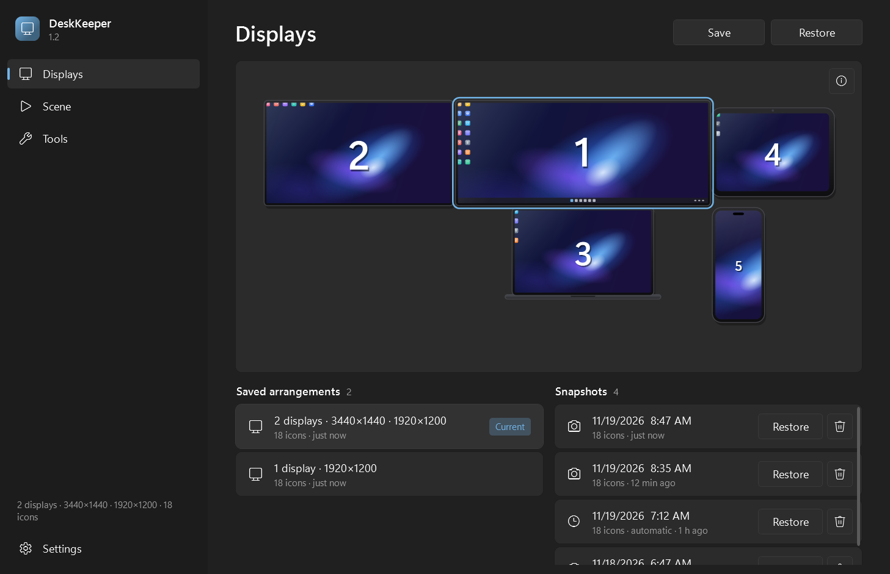
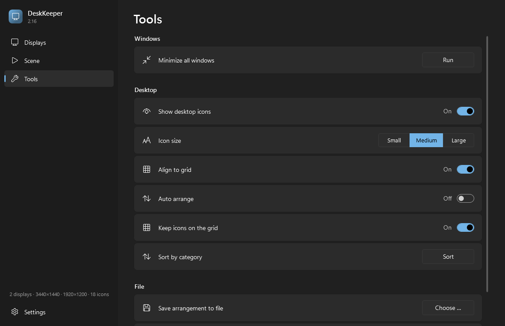
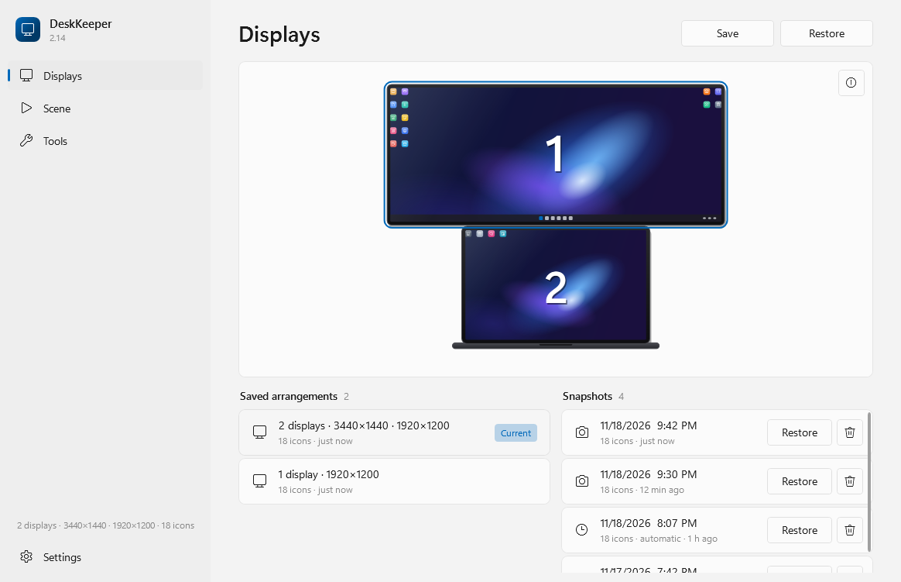

<div align="center">

# DeskKeeper

**Your desktop icons. Exactly where you left them.**

Windows has one job when you plug in a monitor: remember where your icons were.
It has been failing at that job since roughly 1995. DeskKeeper does it instead.


[Download](../../releases) · [Watch the 30-second promo](docs/media/deskkeeper-promo.mp4) · English · [Deutsch](#deutsch) · [Русский](#русский)

</div>

---

## The problem

You have a laptop. You have a lovely ultrawide. You spent a Sunday afternoon sorting your desktop icons into a layout so beautiful it should be in a museum.

Then you unplug the monitor. Windows panics and stacks everything onto the laptop screen. You plug it back in. Windows looks at your carefully curated layout and does a little shuffle dance with it. *Your Steam icon is now next to your tax returns.*

## The fix

DeskKeeper sits quietly in the tray and remembers your icon layout **per display arrangement** – which screens are connected, where they sit, which one is the main display, resolution and scaling.

- **Monitor plugged in, unplugged, laptop lid closed, main display swapped?** DeskKeeper waits until Windows has finished its shuffle, then puts every icon back.
- **It knows which screen an icon belongs to.** Not just "x = 1200", but "on the LG ultrawide, 120 px from the left". So icons land on the right device even when you move screens around or switch the main display.
- **Never seen this combination before?** Icons go back to the screen they last lived on. Different resolution on the same screen? Positions are scaled proportionally.
- **Windows forgot everything after a reboot?** Restored a few seconds after startup.
- It never saves Windows' own mess under your good layout. That was the whole point.

## Features

| | |
|---|---|
| **Displays view** | Your screens drawn as real devices – monitor, laptop, tablet, phone, TV, wireless or virtual displays – to scale, with your actual icons on them. Click a device to zoom in, hover an icon to see exactly where it sits. |
| **Snapshots** | Save a layout whenever you like, restore it later, or remove it (it goes to a recycle folder, not into the void). Automatic snapshots every 5/15/60 minutes, only when something changed. |
| **Saves when it matters** | On shutdown, on user switch / lock, and on exit. |
| **Restores when it matters** | At Windows startup, at app start, and whenever the display arrangement changes. Instantly – or with DUM-E (see below). |
| **Sort by category** | One click puts system icons top left, social apps and browsers top centre, Office top right, video and image tools next to it, development tools bottom left, games and launchers bottom centre, everything else bottom right. A snapshot is taken first, so you can go back. |
| **Keep icons on the grid** | Every restore snaps icons into grid cells, also after a scene. During scenes the grid stays on: icons DUM-E is carrying are drawn by the scene, the real icon only jumps between fixed cells. |
| **Tools** | Minimize all windows, show/hide desktop icons, icon size, align to grid, auto arrange, save/load a layout to a file. |
| **Feels native** | Detects Windows 10 or 11 and looks like the system settings of each, dark or light, uses your accent colour. English, Deutsch, Русский. |
| **Tray app** | Starts with Windows if you want, starts minimized, closes to the tray, remembers its window position. |

<p align="center">
   
   
   
</p>

## What's new in 1.1

- **Sort by category** (Tools page).
- **Keep icons on the grid** (Tools page, on by default). Fixes icons that ended up slightly off the grid after a scene.
- **Scenes are always visible:** open windows are moved aside (like Win+D) for the scene and come back afterwards.
- **Restoring a snapshot** puts icons that are only a few pixels off straight back instead of letting DUM-E carry each one.
- **Icon centres are measured** instead of estimated, so ash and explosions sit exactly on the icons.
- **DUM-E moves more smoothly:** no jumps, no snapping back.

## DUM-E, the slightly unnecessary part

Restoring icons instantly is efficient. It is also boring.

Switch *Restore style* to **With DUM-E** and a small top-down robot arm with a trailer drives across your actual desktop, picks up each misplaced icon and carries it home. One icon at a time. Slowly. With dignity. It runs *behind* your windows, so you can keep working while it works.

And if you are having a really bad day, the **Scene** page lets you nuke your desktop first – a Jericho strike, a mushroom cloud, or a Tu-160M bomber run. Icons turn to ash. DUM-E then rebuilds everything, exactly as it was. Therapy, basically.

<p align="center"></p>

## Coming soon™

DeskKeeper's serious part is done. The unserious part is just getting started. Planned, in no particular order, added over time:

- **More ways to destroy your desktop** – more weapons, more physics, more ash.
- **More helpers than DUM-E** – other robots, and pets: a cat that knocks your icons off their spots, a dog that fetches them back, maybe a vacuum robot that sucks them up and drops them where they belong.
- **Helpers that do more than tidy up** – some put icons back, some rearrange them, and some just move things around a little for fun. (Off by default. We are not monsters.)

Got an idea for a weapon or a pet? [Open an issue](../../issues) – the sillier, the better.

## Download & install

1. Grab `DeskKeeper.exe` from [Releases](../../releases). It is a single portable file; no installer, no .NET needed.
2. Run it. It appears in the tray.
3. Arrange your icons once per display setup. DeskKeeper remembers the rest.

Settings and layouts are stored in `%LOCALAPPDATA%\DeskKeeper`. Nothing is sent anywhere – DeskKeeper has no network code at all.

Windows 10 and 11, x64. "Auto arrange icons" must be off for positions to be restorable (DeskKeeper's Tools page has the switch).

## Build from source

```bash
dotnet build src/DeskKeeper.csproj -c Release
```

Requires the .NET 10 SDK. `DeskKeeper.exe --check <folder>` runs the built-in test suite (keeper logic, per-display placement, scenes) and writes `pruefung.json`.

## How it works (for the curious)

- Icon positions are read and written through Explorer's own shell view (`IFolderView` / `IFolderView2`) – no simulated mouse drags, no registry hacks.
- Each display is identified by its device path from the Windows display configuration (`QueryDisplayConfig`), so it stays the same screen even if Windows renumbers it. Device type comes from the connection type, the physical size in the EDID and touch support.
- A layout is only saved after it has been stable for two checks, and never while the display arrangement is changing.

Code comments are mostly German. The icons do not mind.

## License

MIT, see [LICENSE](LICENSE). The Tu-160M outline is adapted from a CC BY-SA 3.0 drawing, see [NOTICE](NOTICE.md).

---

## Deutsch

**DeskKeeper merkt sich deine Desktopsymbole – pro Bildschirmanordnung.** Monitor ab, Monitor an, Notebook zugeklappt, Hauptbildschirm gewechselt: Windows mischt die Symbole durch, DeskKeeper stellt sie zurück. Jedes Symbol kommt auf den Bildschirm, auf dem es zuletzt lag. Mit Schnappschüssen, automatischem Speichern beim Herunterfahren, Benutzerwechsel und Beenden, Ordnen nach Kategorien, festem Raster, Werkzeugen wie bei DesktopOK und einer Ansicht, in der du siehst, wo jedes Symbol liegt. Sieht unter Windows 10 und 11 jeweils wie das System aus. Wer möchte, lässt die Symbole vom kleinen Roboterarm DUM-E zurücktragen – nachdem man sie zur Entspannung kurz in die Luft gesprengt hat.

**Geplant:** weitere Zerstörungseffekte sowie weitere Roboter und Haustiere, die Symbole zurückbringen, neu anordnen oder einfach ein bisschen verschieben. Kommt nach und nach dazu.

## Русский

**DeskKeeper запоминает расположение значков для каждой конфигурации экранов.** Отключили монитор, подключили обратно, закрыли ноутбук, сменили основной экран — Windows перемешивает значки, DeskKeeper возвращает их на место, каждый на тот экран, где он был. Снимки, автосохранение при выключении, смене пользователя и выходе, раскладка по категориям, фиксированная сетка, инструменты как в DesktopOK и вид, где видно, где лежит каждый значок. Выглядит как родное приложение в Windows 10 и 11. А по желанию значки обратно отнесёт маленький робот Дубина — после того как вы их для настроения взорвёте.

**В планах:** новые эффекты разрушения, а также другие роботы и питомцы, которые возвращают значки на место, переставляют их или просто немного двигают. Будет добавляться постепенно.
